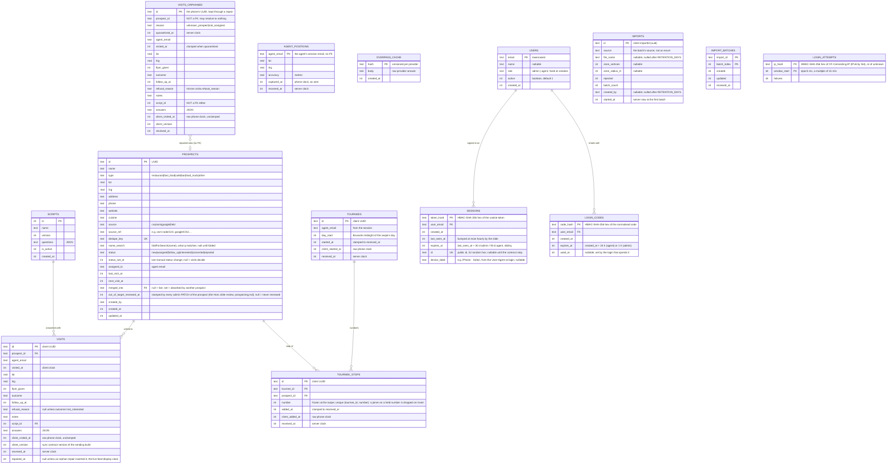

# Data model

Source of truth: `src/worker/db/schema.ts`. This page explains it. Timestamps are epoch milliseconds (integer). IDs of rows created on a phone are client UUIDv4.

`users` and `sessions` are our own login ([ADR-0029](adr/0029-own-login-instead-of-cloudflare-access.md)).
A user is deactivated, never deleted, and `role` is set once, at creation ([ADR-0037](adr/0037-admins-leave-the-field-side.md)). The browser holds a random 32-byte token in the
`__Host-cp_session` cookie (`HttpOnly; Secure; SameSite=Strict; Path=/`); only its
HMAC-SHA-256 under `AUTH_PEPPER` is stored, so a leaked table opens no session. A session
counts while `expires_at` is in the future and its user is `active`; the role is read from
`users` on every request. The expiry slides: a request at least an hour after `last_seen_at`
sets it to now and `expires_at` to now + the role's lifetime (30 d admin, 90 d agent) in one
conditional `UPDATE`, and re-sends the cookie. `id` is a random public id the Utilisateurs page revokes a
device by, so the hash never leaves the Worker; it is NOT NULL. `device_label` is parsed from
the User-Agent at login ("iPhone · Safari"); the raw header is never stored. The nightly sweep
deletes rows with `expires_at` in the past, however long since the session was last seen.

`login_codes` holds the one-time codes an admin generates for a device to enrol
([identity-access](domains/identity-access.md)). A code is 8 Crockford base32 characters (40
random bits); only the HMAC-SHA-256 under `AUTH_PEPPER` of its normalised form
(`src/shared/credential.ts`) is stored, never the code. Generating deletes the user's unused codes in
the same batch, so at most one works. A login spends a code with one conditional `UPDATE … SET
used_at` (unused, unexpired, user active, and the role and email the form asks for:
[api](api.md#sign-in)), so of two racing logins only one gets the row. Used and
expired rows go in the nightly sweep: it deletes every row past `expires_at`, and a used code expires
when its role's lifetime (24 h for an agent, 1 h for an admin) runs out.

`imports` and `import_batches` are the import log ([ADR-0030](adr/0030-the-server-keeps-an-import-log.md)).
The first batch of a run writes the `imports` row (`started_at` is the server's `now`); every batch
writes one `import_batches` row, both `onConflictDoNothing`, so a re-sent batch keeps its first
counts. An import's `created` and `updated` are the sum of its batch rows and its status
(`done`, `interrupted`, or still running and unlisted) is derived on read, never stored. The
nightly sweep nulls `created_by` and `file_name` once `started_at` is older than `RETENTION_DAYS`
and keeps the counts; `import_batches` holds nothing personal and is never redacted.

`login_attempts` counts failed logins per IP in fixed 15-minute windows (CAP-7,
`src/worker/login-throttle.ts`). The IP is personal data, so only its HMAC under `AUTH_PEPPER`
is stored, and an IPv6 address counts by its /64. Each login reserves a failure with an upsert
that adds one only while the row is under 10, and gives it back unless the login answers 400 or
401; a row at 10 refuses the IP until the window ends. The nightly sweep deletes a row once its window
has ended, so it never lifts a lockout early.

`agent_positions` holds at most one row per assignable agent: the latest reading the phone
offered at sync. It is the one upsert on an agent's behalf, allowed by
[ADR-0028](adr/0028-agent-position-at-sync.md); it is served only while
`min(captured_at, received_at)` is today in Brussels and the nightly retention sweep
deletes the rest. No history, no index beyond the primary key.

`overpass_cache` holds **both** map providers' raw answers (ADR-0020) and keeps the
name of its first one. The hash is SHA-256 of a provider-specific query version plus
the normalised shape — `v1` and a rounded polygon for Overpass, `gv1` and a rounded
centre and radius for Google — so two providers cannot read each other's rows. The
daily sweep deletes rows older than the longer of the two provider TTLs (`map-cache.ts`).

`source` distinguishes `osm` from `google` because the two differ in licence, in
freshness and in `source_ref` format, and because the same restaurant found through
both imports twice: tier 1 of the dedupe key is the source's own id, and `node/4711`
is not `google/ChIJ…`. The duplicates sweep is what resolves that pair.

`visits_orphaned` holds visits the server took but could not place
([ADR-0022](adr/0022-quarantine-visits-the-server-cannot-take.md)): the prospect does not
exist, or it belongs to another agent. It mirrors `visits` so a repair is a straight
copy, and carries no foreign keys at all — `prospect_id` pointing at nothing is the
state the table exists to hold, and `script_id` follows the same rule sync already
applies, where an unknown questionnaire is nulled rather than costing the visit.

Rows leave it in exactly two ways: repaired, which inserts into `visits` and deletes
here in one batch, or discarded by an admin. Once a visit is quarantined the phone has
been told it is `accepted` and has dropped it, so this table is the only copy.

## Rules
- **A visit is kept for ever; its personal fields are not.** `lat`, `lng` and `notes` are nulled once `received_at` is older than `RETENTION_DAYS` (90), by a daily Cron Trigger ([ADR-0023](adr/0023-retention-by-redaction.md)). This is the single exception to `visits` being append-only: no row is deleted and nothing sync or the derived status reads is touched.
- A quarantined visit is not in the prospect's history or the live feed until it is repaired. Why it is still reported in `accepted`: [field-operations](domains/field-operations.md#rules).
- **Tournées and stops are insert-only** ([ADR-0036](adr/0036-a-swipe-freezes-each-agents-numbered-tournee.md)). A tournée is one agent's day: every tournée is stored, and the one with the earliest `client_started_at` of the agent's day (the id breaks a tie) is the one read, so the earliest swipe wins whichever phone syncs first; the losing phone's stops are stored on its own tournée and never read, while a stop whose field prospect has not arrived yet is not accepted and waits for a resend until its tournée's Brussels day has passed, then it is accepted and not stored. A stop is unique per `(tournee_id, prospect_id)`. Two phones can append different joiners under one number, so the unique `(tournee_id, number)` index decides it, through `onConflictDoNothing`: the first stored keeps the number, the other stop is accepted and dropped, and the losing phone re-appends its prospect as the next number on its next pull. "A stop left" (`left` in the sync response) is derived from the prospect's assignment, status and merge, and from today's visits, in `isStopLeft`; never written. Neither table holds a position, so the retention sweep gains none. Visits carry no tournée id: which stop and which day come from the agent, the prospect and the Brussels day of `visited_at`.
- **Visits are append-only.** Never updated, never deleted by the app. A revisit is a new row.
- **Answers live on the visit** as JSON, keyed by question `key`. The visit references the exact `script_id` (a specific version), so answers stay interpretable after the script changes.
- **Scripts are immutable per version.** Editing a script creates version N+1 and makes it active.
  Two partial/unique indexes hold the rules the domain doc states rather than trusting the route:
  `scripts_one_active_idx` is unique on `is_active` **where `is_active = 1`**, so any number of old
  versions rest outside it and two live ones cannot exist; `scripts_name_version_idx` makes
  `(name, version)` the real identity of a version. A visit references the script's `id`, never its
  version number, so renumbering a version never rewrites history.
- **An unknown `script_id` arriving on a visit is nulled, not rejected.** It is a foreign key, so a
  phone holding a visit answered against a script this database does not have would otherwise fail
  the whole chunked insert. The visit is still true — only the questionnaire reference is stale — and
  INVARIANT 5 says never lose one. See `src/worker/routes/agent.ts`.
- **`status_set_at` is written only by an admin's `PATCH` that carries `status`.** A visit dated at or before it keeps its hands off `status` and `next_visit_at` ([prospecting](domains/prospecting.md#prospect-lifecycle)).
- **Clocks on a visit.** `visited_at` is when it happened (phone clock), `received_at` is when the server got it. `repaired_at` is null on a synced visit and set at insert by an orphan's repair, to the repair's clock; the live feed shows and orders by `coalesce(repaired_at, received_at)`, so a repaired visit is listed from the repair on, while `received_at` never moves. The feed's cursor is none of these clocks but the table's `rowid` (insertion order, which `received_at` is not: it is stamped when the request starts). Visits are never deleted, so it only grows. History uses `visited_at`.
- **`visited_at` is clamped** on insert ([prospecting](domains/prospecting.md#prospect-lifecycle)); the
  unclamped value stays in `client_visited_at`.
- **`client_version` records the sync contract version of the build that sent the visit.** It makes
  "have all phones upgraded?" a SQL query instead of a log search, which is the gate for raising
  `MIN_CLIENT_VERSION` once the data stage is protected (`sync-contract-change` skill).
- **Identity is a session.** A `sessions` row of an active `users` row names the caller and its role ([ADR-0029](adr/0029-own-login-instead-of-cloudflare-access.md), [identity-access](domains/identity-access.md)). Stored rows identify a user by email.
- **Users are deactivated, never deleted, and one active admin always remains.** Deactivating deletes the user's `sessions` and unused `login_codes` in the same D1 batch; reactivating leaves none. A change that would leave no active admin is refused inside the `UPDATE` itself (`PATCH /api/admin/users/:email`, 409 `last_admin`), so two concurrent changes cannot both pass.
- **A merge is soft.** `merged_into` points at the survivor; nothing is deleted and no visit is
  repointed, because visits are append-only. The absorbed prospect keeps its own visits, its own
  status and its own dedupe key, which is what makes a merge reversible
  ([prospecting](domains/prospecting.md#merging)).
- **`name_search` is `foldForSearch(name)`, written with `name` by every write** (import, PATCH, field prospect, dev seed). It is null only for a row written before the column existed or inserted by the previous Worker during a deploy; the daily sweep folds those, and `q` matches them the old way meanwhile. A rename by the previous Worker in that window leaves a stale fold the sweep does not see ([ADR-0032](adr/0032-a-stored-folded-name-for-search.md)). No index: a `%needle%` cannot use one.
- **Every query that lists live prospects filters `merged_into IS NULL`.** That is the admin list and
  its count, the agent's sync pull, and the duplicate sweep. The import instead *follows* the
  pointer: a key landing on an absorbed row updates the survivor.

## Indexes

| Index | Serves |
|---|---|
| `prospects(dedupe_key)` unique | import upsert, field-prospect dedupe |
| `prospects(assigned_to, status)` | sync pull |
| `prospects(status)` | admin list filtered by status; the dashboard's manual conversions (Convertis) |
| `prospects(source)` | admin list filtered by source (`csv`, `osm`, `google`, `field`) |
| `prospects(updated_at)` | admin list default order |
| `prospects(merged_into)` | live-prospect filter, and finding what a survivor absorbed |
| `visits(prospect_id, visited_at)` | visit history on a prospect |
| `visits(received_at)` | export, recap, retention sweep |
| `visits(agent_email, visited_at)` | an agent's own history |
| `visits(visited_at)` | the dashboard's period counts, across every prospect and agent |
| `tournees(agent_email, day_start, client_started_at, id)` | the sync pull's "today's tournée": the earliest swipe of the agent's day |
| `tournee_stops(tournee_id, prospect_id)` unique | one stop per prospect per tournée; a tournée's stops |
| `tournee_stops(tournee_id, number)` unique | one prospect per number in a tournée; of two joiners under one number the first stored keeps it |
| `tournee_stops(prospect_id)` | the foreign key to `prospects` |
| `scripts(is_active)` | the sync pull's "which script is live" |
| `scripts(is_active)` unique **where `is_active = 1`** | "exactly one active script at a time" |
| `scripts(name, version)` unique | a version is a version *of* a script |
| `visits_orphaned(quarantined_at)` | the repair queue's only ordering |
| `imports(started_at)` | `GET /api/admin/imports`, the 20 newest |
| `sessions(user_email)` | a user's sessions: signing every device out on deactivation, the Utilisateurs page's device list |
| `sessions(id)` unique | revoking one device by its public id |
| `login_codes(user_email)` | a user's codes: superseding them on generate, deleting them on deactivation |

SQLite uses one index per table reference, so a filtered *and* sorted admin list
(`status=X` ordered by `updated_at`) filters on the index and then sorts the
matches in memory. Composite `(status, updated_at)`-style indexes would remove
that sort, and were deliberately not added: at the few thousand prospects this
project plans for, the sort is negligible, and three more indexes would cost a
write on every imported row. Revisit if the base grows by an order of magnitude.

No index on `visits_orphaned(reason)`. An empty queue is the healthy state and the page
is capped at 200, so filtering it is a scan over a handful of rows; an index would cost a
write on every quarantined visit to save nothing measurable.
